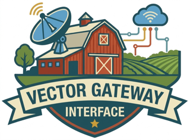

<p align="center">
  
</p>

<p align="center"><em>A Query.Farm VGI worker for DuckDB.</em></p>

# Query SNMP Devices — GET, Walk & MIB Tables — in DuckDB

> **vgi-snmp** · a [Query.Farm](https://query.farm) VGI worker · written in Python · powered by [pysnmp](https://www.pysnmp.com/)

[](https://github.com/Query-farm/vgi-snmp/actions/workflows/ci.yml)
[](https://query.farm)

Routers, switches, servers, printers and UPS units all speak SNMP. This worker turns
them into SQL tables: `GET` specific instances, walk a subtree, or read a MIB table such
as `ifXTable` or `hrStorageTable` **as typed rows with one column per MIB column**. It
supports SNMP v1, v2c and v3 (USM authentication and privacy), and keeps credentials out
of your queries with host-scoped DuckDB secrets.

```sql
-- Interface traffic, one row per interface, Counter64 as UBIGINT.
SELECT ifName, ifHCInOctets, ifHCOutOctets
FROM snmp.main.snmp_table('10.0.0.1', 'ifXTable')
ORDER BY ifHCInOctets DESC;

-- Disk and memory use from HOST-RESOURCES-MIB.
SELECT hrStorageDescr, round(100.0 * hrStorageUsed / nullif(hrStorageSize, 0), 1) AS pct_used
FROM snmp.main.snmp_table('10.0.0.1', 'hrStorageTable');

-- Specific instances.
SELECT object, value FROM snmp.main.snmp_get('10.0.0.1', 'sysName.0', 'sysDescr.0', 'sysUpTime.0');
```

## Quick start

**Prerequisites:** [uv](https://docs.astral.sh/uv/) and DuckDB 2.0 (or
[Haybarn](https://query.farm/products/haybarn)).

```sql
SET allow_extension_repositories = 'allowed';
CREATE EXTENSION REPOSITORY IF NOT EXISTS query_farm WITH PREFIX 'https://duckdb-extensions.query.farm';
INSTALL vgi FROM query_farm;
LOAD vgi FROM query_farm;

ATTACH 'snmp' (TYPE vgi, LOCATION 'uvx --from git+https://github.com/Query-farm/vgi-snmp@v0.1.0 vgi-snmp-worker');
```

On Haybarn use `INSTALL vgi FROM community; LOAD vgi;` instead of the first four lines.

**From a checkout:**

```bash
make build
```

```sql
ATTACH 'snmp' (TYPE vgi, LOCATION '/abs/path/to/vgi-snmp/.venv/bin/vgi-snmp-worker');
```

Use an absolute path: a relative `LOCATION` resolves against DuckDB's working directory.

## Functions

| Function | What it does |
|---|---|
| `snmp_get(host, oid, ...)` | `GET` one or more instances: one row per OID, in argument order. Missing ones are rows typed `noSuchObject` / `noSuchInstance`. |
| `snmp_walk(host, oid, max_repetitions := 25)` | Every instance under a subtree, like `snmpbulkwalk` (GETBULK on v2c/v3, GETNEXT on v1). Streams in OID order, so `LIMIT` ends the walk early. |
| `snmp_table(host, table, max_repetitions := 25)` | A MIB conceptual table as typed rows, like `snmptable`. Only the columns your query uses are fetched. |
| `snmp_oid(name)` | Offline: `'IF-MIB::ifInOctets.3'` → `'1.3.6.1.2.1.2.2.1.10.3'`. NULL for unknown names. |
| `snmp_oid_name(oid)` | Offline: `'1.3.6.1.2.1.1.3.0'` → `'SNMPv2-MIB::sysUpTime.0'`. |
| `snmp_mib_objects(module := NULL, kind := NULL)` | Offline: every object in the loaded MIBs, with OID, syntax, access, units and description. |

**OIDs** can be numeric (`1.3.6.1.2.1.1.5.0`) or MIB names (`sysName.0`,
`IF-MIB::ifHCInOctets.2`). Scalars need their `.0` instance suffix.

**`snmp_get` / `snmp_walk` columns:** `host`, `oid`, `name` (`SNMPv2-MIB::sysName.0`),
`object` (`sysName`), `instance` (`0`), `type` (SNMP type: `INTEGER`, `OCTET STRING`,
`Counter64`, `TimeTicks`, ...), `value` (display text formatted by the MIB: enum labels,
MAC addresses, strings), `value_int` (`DECIMAL(20,0)`, exact for every integer type
including Counter64), and `value_bytes` (`BLOB`, raw octets).

**`snmp_table` columns** come from the MIB at bind time, so `DESCRIBE` works without a
device: `_index` (the row's instance suffix), the table's INDEX objects decoded from it
(`ifIndex`, or `ipNetToPhysicalIfIndex, ...NetAddressType, ...NetAddress`), then one column
per readable column object, named after it. Counter64 becomes `UBIGINT`, other integers
`BIGINT`, enumerations their label (`'up'`), and everything else display text. Tables
that augment another (`ifXTable` augments `ifTable`) share its index:

```sql
SELECT t.ifDescr, t.ifOperStatus, x.ifAlias, x.ifHighSpeed
FROM snmp.main.snmp_table('10.0.0.1', 'ifTable') t
JOIN snmp.main.snmp_table('10.0.0.1', 'ifXTable') x USING (_index);
```

`TimeTicks` are hundredths of a second (`sysUpTime.0 / 8640000.0` days). OIDs are
`VARCHAR`; sort them numerically with `ORDER BY string_split(oid, '.')::INTEGER[]`.

OID-valued columns decode offline with `snmp_oid_name`. `hrStorageType`, for example,
tells RAM from fixed disks:

```sql
SELECT split_part(snmp.main.snmp_oid_name(hrStorageType), '::', 2) AS storage_type,
       hrStorageDescr,
       round(hrStorageUsed * hrStorageAllocationUnits / 1e9, 2) AS used_gb
FROM snmp.main.snmp_table('10.0.0.1', 'hrStorageTable')
ORDER BY storage_type, hrStorageDescr;
```

### Connection arguments

Every device function takes these named arguments:

| Argument | Default | Meaning |
|---|---|---|
| `version` | `'3'` if a v3 user is configured, else `'2c'` | `'1'`, `'2c'` or `'3'` |
| `community` | secret, then `SNMP_COMMUNITY`, then `'public'` | v1/v2c community |
| `port` | 161 | UDP port (or write `host:port`, `[v6addr]:port`) |
| `timeout` | 2.0 | seconds to wait for each response |
| `retries` | 1 | retransmissions after a timeout |
| `context` | `''` | SNMPv3 context name |

A wrong community or v3 credential gets no answer from most agents, so it shows up as a
timeout that names the agent.

### Polling several devices

Each call queries one agent. `UNION ALL` one call per device:

```sql
SELECT 'core1' AS device, * FROM snmp.main.snmp_table('10.0.0.1', 'ifXTable')
UNION ALL
SELECT 'core2', * FROM snmp.main.snmp_table('10.0.0.2', 'ifXTable');
```

## Credentials

Keep credentials out of queries with a DuckDB secret of type `snmp`. Its `SCOPE` is
matched as a prefix of `snmp://<host>:<port>`, and the longest match wins, so one secret
can cover a single agent (`'snmp://10.0.0.1:'`), a subnet (`'snmp://10.0.0.'`) or
everything (`'snmp://'`):

```sql
-- v2c community for one subnet.
CREATE SECRET lab (TYPE snmp, SCOPE 'snmp://10.0.0.', COMMUNITY 'lab-ro');

-- SNMPv3 authPriv for the core routers. The version defaults to 3 once a user is set.
CREATE SECRET core (TYPE snmp, SCOPE 'snmp://10.1.0.',
    USER 'monitor', AUTH_PROTOCOL 'sha256', AUTH_KEY 'auth-passphrase',
    PRIV_PROTOCOL 'aes', PRIV_KEY 'priv-passphrase');
```

| Secret field | Values |
|---|---|
| `community` | v1/v2c community |
| `user` | SNMPv3 user (security name) |
| `auth_protocol` | `none`, `md5`, `sha`, `sha224`, `sha256`, `sha384`, `sha512` (default `sha` when `auth_key` is set) |
| `auth_key` | authentication passphrase |
| `priv_protocol` | `none`, `des`, `3des`, `aes` (= `aes128`), `aes192`, `aes256`, `aes192blmt`, `aes256blmt` (default `aes` when `priv_key` is set) |
| `priv_key` | privacy passphrase |

Without a matching secret, the worker reads `SNMP_COMMUNITY`, `SNMP_USER`,
`SNMP_AUTH_PROTOCOL`, `SNMP_AUTH_KEY`, `SNMP_PRIV_PROTOCOL` and `SNMP_PRIV_KEY` from its
environment. A `community := '...'` argument overrides both. Credentials are never logged
or stored in scan state.

## MIBs

Names resolve offline against the MIB modules bundled with pysnmp (SNMPv2-MIB and the
SNMP framework MIBs) plus pre-compiled IETF, IANA and Net-SNMP modules in
[`src/snmp_worker/mibs/`](src/snmp_worker/mibs/): IF-MIB, IP-MIB, IP-FORWARD-MIB,
IPV6-MIB, TCP-MIB, UDP-MIB, HOST-RESOURCES-MIB, ENTITY-MIB, ENTITY-SENSOR-MIB,
EtherLike-MIB, DISMAN-EVENT-MIB, UCD-SNMP-MIB, NET-SNMP-MIB, NET-SNMP-AGENT-MIB and
IF-INVERTED-STACK-MIB.

```sql
SELECT module, name FROM snmp.main.snmp_mib_objects(kind := 'table') ORDER BY module, name;
```

**Vendor MIBs.** Compile them with [pysmi](https://www.pysnmp.com/pysmi) and point
`SNMP_MIB_DIRS` (a `:`-separated list; `;` on Windows) at the output directory before
DuckDB starts the worker:

```bash
uvx --from pysmi mibdump --destination-directory ~/mibs --generate-mib-texts \
    --mib-source file:///path/to/vendor/mibs --mib-source https://mibs.pysnmp.com/asn1/@mib@ \
    CISCO-PROCESS-MIB
export SNMP_MIB_DIRS=~/mibs
```

Anything not in a loaded MIB still works numerically: `snmp_walk` and `snmp_get` return
the numeric OID, the deepest known name (`SNMPv2-SMI::enterprises.9.9.109...`), the SNMP
type and the raw value.

## Development

```bash
make check        # everything CI runs: ruff, mypy, pydoclint, pytest, SQL tests over stdio/launch/http, vgi-lint
make test-unit    # fast unit tests
make test-sql     # test/sql/*.test through DuckDB (TRANSPORT=stdio|launch|http)
make lint-explain # metadata report (vgi-lint), settings in vgi-lint.toml
```

The tests never touch a real network device. `test/snmp_agent/serve.py` runs
[snmpsim](https://www.pysnmp.com/snmpsim) on a random local UDP port with the records in
`test/snmp_agent/data/` (communities `public` and `private`), a generated 2,500-interface
device (community `big`) for multi-batch streaming, and an SNMPv3 user (`simulator`, SHA
`auctoritas`, AES `privatus`; snmpsim picks the data by context name, so v3 tests pass
`context := 'public'`).

The device functions' catalog examples use documentation addresses (RFC 5737
`192.0.2.0/24`), so vgi-lint's scan probe is waived for them in `vgi-lint.toml`; the SQL
tests cover them instead.

`stdout` carries the Arrow protocol, so log to stderr (`logging`; `--debug` turns it up).
The worker also serves HTTP (`vgi-snmp-worker --http --port 8000`, or the `Dockerfile`).
A worker running in a container needs a network path (UDP 161) to the devices it polls.

Layout:

```
src/snmp_worker/
  worker.py        # assembles the catalog (FUNCTIONS)
  meta.py          # catalog/schema metadata
  client.py        # targets, credentials, the `snmp` secret type, GET/GETNEXT/GETBULK
  mib.py           # MIB loading, name/OID resolution, value rendering and typing
  common.py        # connection arguments and the varbind result schema
  snmp_get.py      # snmp_get
  snmp_walk.py     # snmp_walk (resumable cursor)
  snmp_table.py    # snmp_table (MIB-typed schema, projection pushdown, streaming)
  oid_functions.py # snmp_oid, snmp_oid_name
  mib_objects.py   # snmp_mib_objects
  mibs/            # pre-compiled MIB modules (generated by pysmi)
test/snmp_agent/   # snmpsim fixture agent
test/sql/          # sqllogictest files run through DuckDB
tests/             # pytest unit tests
```

## Support

Open an issue on [this repository](https://github.com/Query-farm/vgi-snmp/issues). For
VGI itself, see [query.farm](https://query.farm).

## Authorship & License

Written by [Query.Farm](https://query.farm). Released under the BSD Zero Clause License
(see [LICENSE](LICENSE)). The bundled MIB modules are derived from IETF, IANA and
Net-SNMP MIB definitions under their own terms; see
[`src/snmp_worker/mibs/README.md`](src/snmp_worker/mibs/README.md).

Copyright 2026 Query Farm LLC - https://query.farm

## Executed notebooks

[Storage units and alert thresholds](notebooks/README.md) — query a synthetic local SNMP agent and compare percentage utilization with absolute free capacity.
